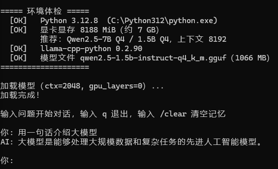

# 本地大模型一键部署（Windows / 家用显卡）

> 一条命令在 Windows 上跑起本地大模型：自动检测显存 → 推荐配置 → 环境体检 → 开始对话。
> 不用懂原理，不用买服务器，有张显卡就行。


---

## 这是什么

一个面向新手的本地大模型部署脚本。核心是 `deploy.py`——它替你做完了最容易出错的三件事：

1. **环境体检**：Python 版本、显卡显存、推理库、模型文件，一次性检查完，缺什么直接告诉你补什么
2. **自动推荐**：读你的显存，告诉你该跑多大的模型、上下文开多少
3. **人话报错**：缺 DLL、缺模型、上下文超限，都给出具体命令，而不是甩一堆 traceback

我用的是 **RTX 4060 8G + Qwen2.5-1.5B**，实测 **105 tok/s**——比人打字快几十倍。

## 效果

<!-- 截图 1：体检通过 -->

<!-- 截图 2：对话效果 -->


```
===== 环境体检 =====
  [OK]   Python 3.12.8  (C:\Python312\python.exe)
  [OK]   显卡显存 8188 MiB（约 7 GB）
         推荐：Qwen2.5-7B Q4 / 1.5B Q4，上下文 8192
  [OK]   llama-cpp-python 0.2.90
  [OK]   模型文件 qwen2.5-1.5b-instruct-q4_k_m.gguf（1066 MB）
====================
```

## 快速开始（3 步）

### 1. 装依赖

```bash
pip install -r requirements.txt
```

如果 `import llama_cpp` 报 `Could not find module 'llama.dll'`，补上 CUDA 运行库：

```bash
pip install nvidia-cuda-runtime-cu12 nvidia-cublas-cu12
```

然后把 `site-packages/nvidia/*/bin/` 下的 `cudart64_12.dll`、`cublas64_12.dll`、`cublasLt64_12.dll`
复制到 `site-packages/llama_cpp/lib/` 目录。

### 2. 下载模型（1GB，走国内镜像）

```bash
curl -L -o models/qwen2.5-1.5b-instruct-q4_k_m.gguf https://hf-mirror.com/Qwen/Qwen2.5-1.5B-Instruct-GGUF/resolve/main/qwen2.5-1.5b-instruct-q4_k_m.gguf
```

> 国内直连 HuggingFace 很慢，`hf-mirror.com` 是官方镜像，把域名换掉即可。

### 3. 运行

```bash
python deploy.py
```

Windows 用户也可以直接双击 `deploy.bat`。

## 参数

| 参数 | 说明 | 示例 |
|---|---|---|
| 无 | 体检 → 加载 → 对话 | `python deploy.py` |
| `--check` | 只体检，不加载模型 | `python deploy.py --check` |
| `--ctx N` | 上下文长度，越大记得越多、越吃显存 | `--ctx 8192` |
| `--cpu` | 强制用 CPU（慢 5 倍，用于对比） | `--cpu` |
| `--gpu-layers N` | 放进显卡的层数，`-1` 为全部 | `--gpu-layers 20` |
| `--model 路径` | 指定模型文件 | `--model D:/models/qwen7b.gguf` |
| `--help` | 查看全部参数 | `--help` |

对话中可用：`q` 退出，`/clear` 清空对话记忆。

## 显存怎么选模型

| 显存 | 建议模型（4bit 量化） | 上下文 |
|---|---|---|
| 4G | Qwen2.5-1.5B | 4096 |
| **8G** | 1.5B 流畅 / 7B 勉强 | 8192 |
| 12-16G | 7B / 14B | 8192 |
| 24G+ | 32B | 8192 |

## 性能实测（RTX 4060 8G / Qwen2.5-1.5B Q4_K_M）

**GPU 层数对速度的影响**

| 配置 | 速度 |
|---|---|
| `n_gpu_layers=0`（纯 CPU） | 18.7 tok/s |
| `n_gpu_layers=-1`（全 GPU） | 105.7 tok/s |

**上下文窗口对显存的影响**

| n_ctx | 显存占用 |
|---|---|
| 未加载 | 596 MiB |
| 256 | 1798 MiB |
| 2048 | 2017 MiB |
| 8192 | 2185 MiB |
| 32768 | 3398 MiB |

> 结论：8G 显卡跑 1.5B 模型开 32K 上下文完全够，还剩 4.7G。
> 实测 KV cache 边际成本约 46 KB/token。

## 常见问题

<details>
<summary><b>1. 下载 447MB 的包要 2 小时</b></summary>

直连 GitHub 的速度只有 53.6 kB/s。用镜像手动下载，再本地安装：

```bash
curl -L -o llama_cpp.whl https://ghfast.top/https://github.com/abetlen/llama-cpp-python/releases/download/v0.2.90-cu121/llama_cpp_python-0.2.90-cp312-cp312-win_amd64.whl
pip install llama_cpp.whl
```
9 分钟搞定。
</details>

<details>
<summary><b>2. 装包报 <code>is not a supported wheel on this platform</code></b></summary>

Python 版本和 wheel 标签不一致。`cp312` 表示给 Python 3.12 的包。
确认当前解释器版本：`python -c "import sys; print(sys.version)"`，然后下对应版本的包。
</details>

<details>
<summary><b>3. import 报 <code>Could not find module 'llama.dll'</code></b></summary>

**显卡驱动 ≠ CUDA 运行库**。装驱动只能让系统识别显卡，程序要用 GPU 还得有 cudart/cublas。

```bash
pip install nvidia-cuda-runtime-cu12 nvidia-cublas-cu12
```
再把 `nvidia/*/bin/` 下的三个 DLL 复制到 `llama_cpp/lib/`。
</details>

<details>
<summary><b>4. .bat 里的中文乱码，还报 "is not recognized as an internal or external command"</b></summary>

批处理存成了 UTF-8，cmd 按 GBK 解析。另存为 ANSI，或在开头加 `chcp 65001`。
</details>

<details>
<summary><b>5. 双击 .py 直接闪退</b></summary>

双击用的是系统默认 Python，可能没装依赖，报错还没看清窗口就关了。
**在终端里运行**，或用本项目提供的 `deploy.bat`（末尾有 pause，报错会停住）。
</details>

<details>
<summary><b>6. 换个目录运行就报 <code>Model path does not exist</code></b></summary>

相对路径的锚点是"你敲命令时所在的目录"，不是脚本所在位置。
本项目的 `deploy.py` 已用 `os.path.dirname(os.path.abspath(__file__))` 修正，从任何目录运行都可以。
自己写脚本时也照这个写法。
</details>

## 目录结构

```
local-llm-easy-deploy/
├── deploy.py            # 主程序
├── deploy.bat           # Windows 双击启动器（支持传参）
├── requirements.txt
├── config.example.json  # 配置示例，运行后自动生成 config.json
├── models/              # 放 .gguf 模型文件（不提交到 git）
└── docs/screenshots/    # README 用的截图
```

## 后续计划

- [ ] 支持自动下载模型（一条命令从零到对话）
- [ ] 加 Web 界面
- [ ] 挂载本地知识库（RAG）
- [ ] 推理加速对比（vLLM / TensorRT-LLM）

## 参考

- [llama-cpp-python](https://github.com/abetlen/llama-cpp-python)
- [Qwen2.5 模型](https://huggingface.co/Qwen/Qwen2.5-1.5B-Instruct-GGUF)

---

如果这个项目帮你省了时间，点个 **Star** ⭐ 就是对我最大的鼓励。
有问题欢迎提 Issue，看到都会回。

## License

MIT
